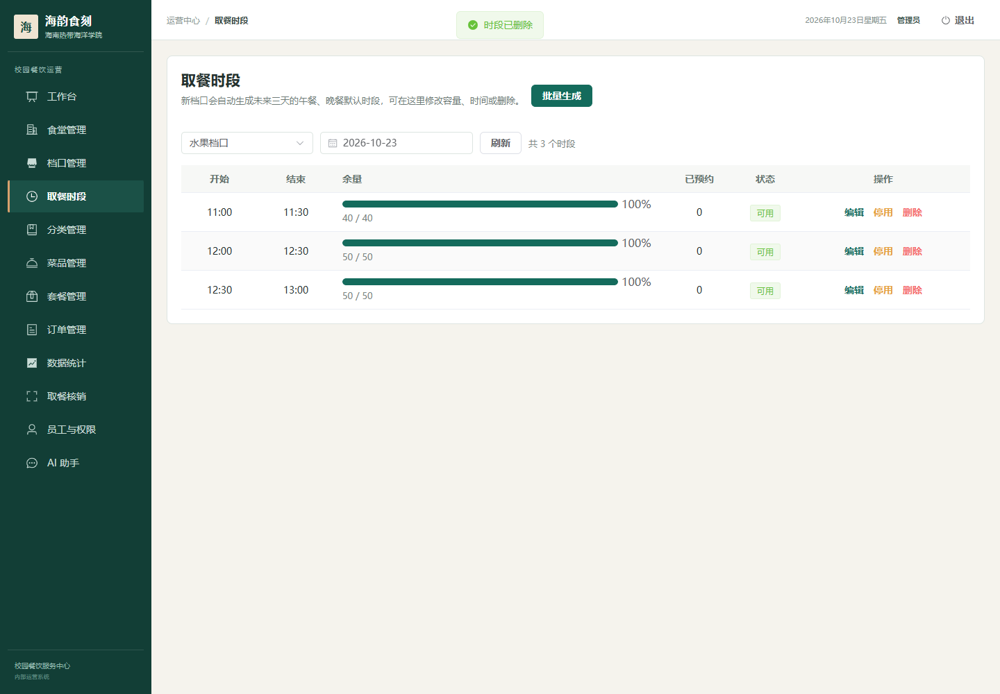
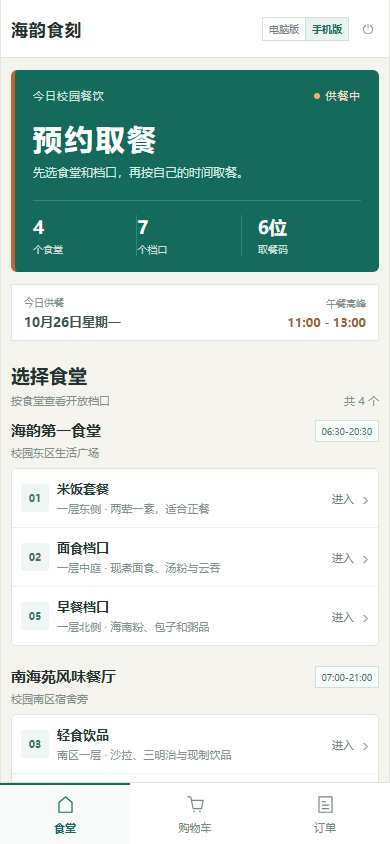
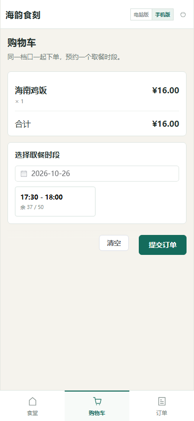
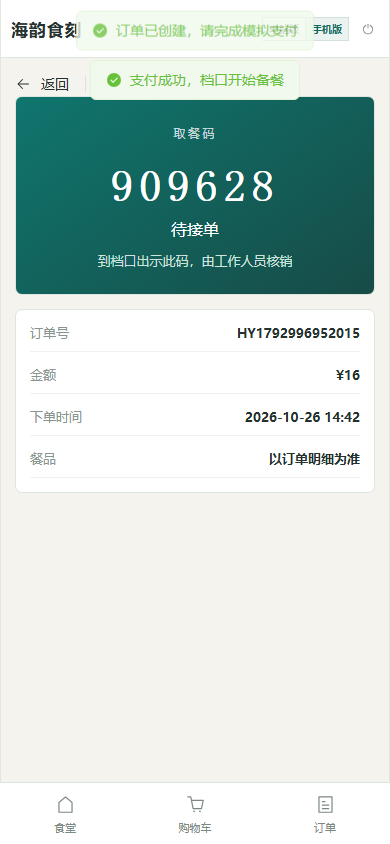
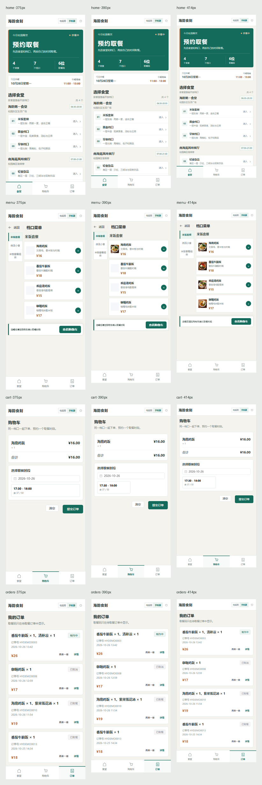

# 海韵食刻 · 校园食堂预约取餐平台

> 学生按「食堂 → 档口 → 菜品 → 取餐时段」预约下单，档口按序备餐，学生凭 6 位取餐码到店核销。

本项目是 Java 后端主导、Vue 3 前端 AI 辅助完成的全栈项目。核心链路覆盖时段容量原子占位、订单状态机、支付回调幂等、超时释放、档口出餐、取餐核销、RBAC 权限、缓存防护和 AI 工具调用。

<p align="center">
  
</p>

## 项目特点

- 校园预约取餐业务，不使用配送、骑手和地址簿模型；
- 下单时对取餐时段做原子占位，取消、拒单和超时关闭只释放一次库存；
- 订单状态迁移集中到状态机，支付与取消使用条件更新避免并发覆盖；
- JWT + RBAC 权限码驱动后端接口校验和前端菜单；
- Redis 实现权限缓存、菜单缓存和 AI 会话记忆；
- Vue 3 管理端与学生 H5，共享统一请求层和接口类型；
- 学生端默认按屏幕宽度切换电脑版/手机版，也可手动切换；
- 真实数据库演示数据和可复现的冒烟测试脚本。

## 界面预览

### 管理端

| 工作台 | 菜品管理 |
|---|---|
|  |  |

| 订单管理 | 数据统计 |
|---|---|
|  |  |

| 取餐时段 | 登录页 |
|---|---|
|  |  |

### 学生端

| 手机首页 | 档口菜单 |
|---|---|
|  |  |

| 购物车与时段 | 取餐码 |
|---|---|
|  |  |

<details>
<summary>查看 375 / 390 / 414 响应式总览</summary>



</details>

> 以上截图来自本地真实页面和演示数据库，不是设计稿或代码生成的占位图。

## 功能

### 学生端 H5

- 学号 + 密码登录；
- 学生注册，学号唯一校验；
- 浏览食堂、档口、分类和菜品；
- 查看菜品详情、口味、价格和说明；
- 购物车按档口隔离；
- 选择当天或后续取餐时段并提交订单；
- 模拟支付；
- 查看历史订单、订单详情和 6 位取餐码；
- 取消未支付/待接单订单，再来一单。

### 管理端

- 管理员登录与 RBAC 权限码；
- 工作台与经营数据；
- 食堂、档口、分类、菜品、套餐管理；
- 取餐时段生成、修改、启停和删除；
- 订单查询、接单、拒单、出餐和取消；
- 取餐码核销与重复核销幂等；
- 员工、角色和权限分配；
- 营业额、订单、用户和销量统计；
- AI 助手会话管理和工具调用。

## 技术栈

| 层次 | 技术 |
|---|---|
| 后端 | Java 21、Spring Boot 3.5、MyBatis、MySQL 8、Redis |
| 权限 | JWT、自定义 `@RequirePermission`、AOP、RBAC |
| 并发与一致性 | 条件更新、订单状态 CAS、唯一索引、支付流水幂等 |
| 可观测性 | traceId、Actuator、Micrometer、Prometheus |
| AI | LangChain4j + 通义千问工具调用 |
| 前端 | Vue 3、Vite、TypeScript、Element Plus、Pinia、Vue Router |
| 部署 | Nginx 静态托管与反向代理 |

前端使用 TypeScript，Vite 构建时会编译为浏览器可执行的 JavaScript 并执行类型检查。

## 项目结构

```text
haiyun-meal/
├─ haiyun-common/   常量、异常、枚举、工具、JWT、配置属性
├─ haiyun-model/    Entity、DTO、VO
├─ haiyun-app/      Controller、Service、Mapper、Config、Task
├─ db/              完整建库脚本、迁移脚本、演示数据
├─ scripts/         API 冒烟测试
├─ screenshots/     README 使用的真实页面截图
├─ web/             Vue 3 管理端与学生 H5
└─ pom.xml
```

## 本地运行要求

| 软件 | 建议版本 |
|---|---|
| JDK | 21 |
| Maven | 3.9+ |
| MySQL | 8.0+ |
| Redis | 6+ / 7+ |
| Node.js | 20+ |
| npm | 10+ |

真实微信支付不是本地运行的必需项；本地默认使用模拟支付。

## 快速开始

### 1. 克隆项目

```powershell
git clone --branch master https://github.com/tlei49377-afk/haiyun-campus-meal.git
cd haiyun-campus-meal
```

后续命令均在项目根目录执行。

### 2. 启动 MySQL 和 Redis

确认 MySQL 8 已启动，并导入演示数据库：

```powershell
cmd /c "mysql --default-character-set=utf8mb4 -uroot -p < db\haiyun_meal.sql"
```

Linux/macOS 等价命令：

```bash
mysql --default-character-set=utf8mb4 -uroot -p < db/haiyun_meal.sql
```

Redis 需要在本机启动。默认连接 `localhost:6379`：

```powershell
redis-server
```

也可以使用 Docker：

```powershell
docker run --rm -d --name haiyun-redis -p 6379:6379 redis:7-alpine
redis-cli ping
```

Redis 返回 `PONG` 即表示可用。

### 3. 创建本地配置

```powershell
Copy-Item haiyun-app\src\main\resources\application-dev.yml.example haiyun-app\src\main\resources\application-dev.yml
```

至少检查以下配置：

```yaml
app:
  datasource:
    host: localhost
    port: 3306
    database: haiyun_meal
    username: root
    password: your-mysql-password

  redis:
    host: localhost
    port: 6379
    password: your-redis-password
    database: 10

  jwt:
    admin-secret-key: please-change-to-a-32-byte-random-string
    user-secret-key: please-change-to-another-32-byte-string
```

说明：

- `application-dev.yml` 已被 `.gitignore` 排除，不能提交真实数据库密码和密钥；
- Redis 没有密码时，将 `password` 留空；
- OSS 配置只有上传新图片时需要；
- 微信配置只有真实微信登录/支付时需要；
- AI 功能可选设置环境变量：

```powershell
$env:QW-API-KEY="your-dashscope-api-key"
```

未配置 AI Key 时，非 AI 业务仍可正常运行。

### 4. 启动后端

```powershell
mvn clean test
mvn -q -DskipTests install
mvn -q -pl haiyun-app spring-boot:run
```

后端默认地址：

- API：`http://localhost:8080`
- 健康检查：`http://localhost:8080/actuator/health`
- 接口文档：`http://localhost:8080/doc.html`

### 5. 启动前端

```powershell
cd web
npm ci
npm run dev
```

开发地址：

- 登录入口：`http://localhost:5173/login`
- 管理端：`http://localhost:5173/admin/dashboard`
- 学生端：`http://localhost:5173/student/home`

Vite 会把 `/api` 和 `/ws` 代理到 `http://localhost:8080`。

### 6. 前端生产构建

```powershell
cd web
npm run build
```

构建产物位于 `web/dist/`。Nginx 示例配置见 `web/conf/nginx.conf`。

## 演示账号

| 端 | 账号 | 密码 | 说明 |
|---|---|---|---|
| 管理端 | `admin` | `123456` | 首次登录后兼容升级为 BCrypt |
| 学生端 | `20230001` | `123456` | 演示学生账号 |

## 验证安装

后端启动后执行冒烟测试：

```powershell
powershell -ExecutionPolicy Bypass -File .\scripts\smoke-test.ps1 -BaseUrl http://localhost:8080
```

脚本会验证：

```text
学生登录
→ 查询食堂/档口/分类/菜品/时段
→ 加入购物车
→ 提交订单
→ 模拟支付
→ 管理员接单
→ 出餐
→ 取餐码核销
```

前端类型检查与构建：

```powershell
cd web
npm run build
```

## 核心业务链路

### 时段占位

```sql
UPDATE pickup_slot
SET booked = booked + 1
WHERE id = ?
  AND status = 1
  AND booked < capacity;
```

占位和订单落库在同一个事务内；影响行数为 0 表示已约满或已关闭。

### 订单状态机

```text
10 待支付 → 20 待接单 → 30 制作中 → 40 待取餐 → 50 已取餐
                                      ↘ 60 已取消
20/30 → 70 已退款
```

支付、超时关闭和人工取消通过 `WHERE id = ? AND status = ?` 条件更新，避免互相覆盖。

### 权限与 traceId

- 登录返回权限码列表；
- 后端通过 `@RequirePermission` + AOP 二次校验；
- 前端按权限码过滤菜单和路由；
- 请求透传 `X-Trace-Id`，前端错误面板支持查看和复制。

## 关键接口

| 方法 | 地址 | 说明 |
|---|---|---|
| POST | `/api/admin/employee/login` | 管理端登录 |
| GET | `/api/admin/canteen/list` | 食堂列表 |
| GET | `/api/admin/stall/list` | 档口列表 |
| POST | `/api/admin/slot/generate` | 批量生成取餐时段 |
| GET | `/api/admin/order/conditionSearch` | 订单分页查询 |
| PUT | `/api/admin/order/confirm` | 接单 |
| PUT | `/api/admin/order/ready/{id}` | 出餐 |
| POST | `/api/admin/order/pickup/verify` | 取餐核销 |
| POST | `/api/app/user/login` | 学生登录 |
| GET | `/api/app/canteen/list` | 学生端食堂列表 |
| POST | `/api/app/order/submit` | 提交订单并占位 |
| PUT | `/api/app/order/payment` | 模拟支付 |

## 常见问题

### MySQL 导入中文乱码

使用：

```powershell
cmd /c "mysql --default-character-set=utf8mb4 -uroot -p < db\haiyun_meal.sql"
```

### 后端启动提示 Redis 连接失败

启动 Redis，并检查 `application-dev.yml` 中的 Redis host、port、password 和 database。

### AI 助手不可用

检查 Redis 是否可用，并设置：

```powershell
$env:QW-API-KEY="your-dashscope-api-key"
```

设置后需要重启后端。

### 前端 401 或登录后没有菜单

确认后端已启动在 8080，重新登录。权限菜单依赖管理员登录返回的权限码。

### 5173 或 8080 端口被占用

关闭占用进程，或在启动配置中修改端口。前端开发代理目标需要与后端端口保持一致。

## 安全说明

- 不要提交 `application-dev.yml`、真实数据库密码、OSS Secret、微信证书或 AI API Key；
- 真实微信支付、生产对象存储和生产数据库需要单独配置；
- 公开部署前应轮换历史密钥并检查 Git 历史；
- 仓库中的演示账号和演示数据仅用于本地学习与展示。
