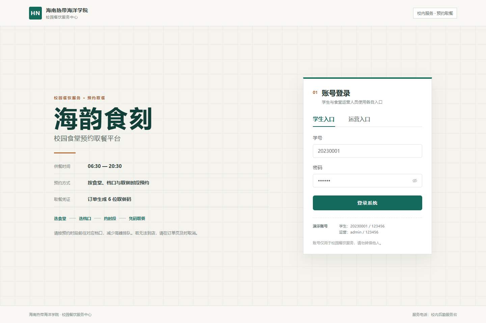
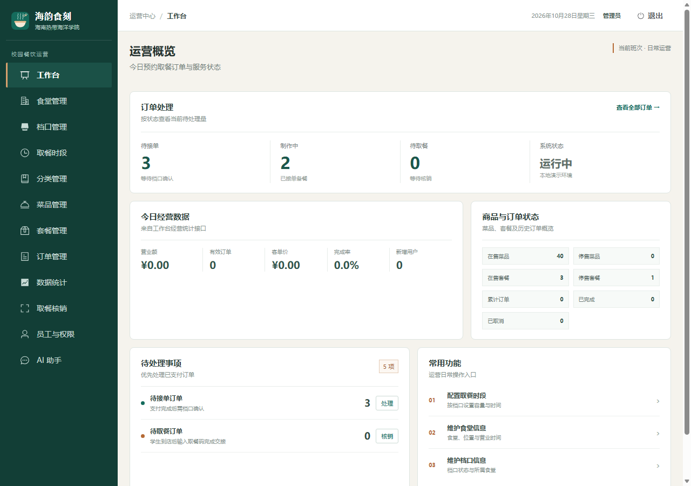
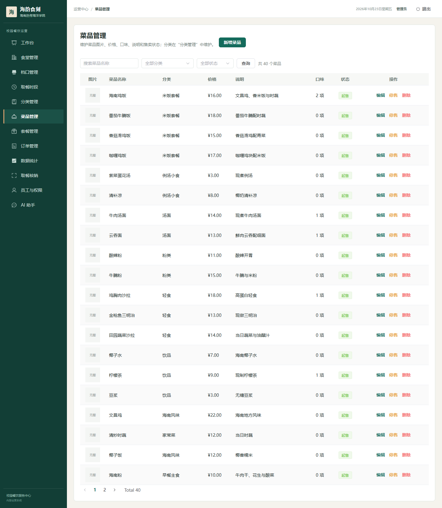
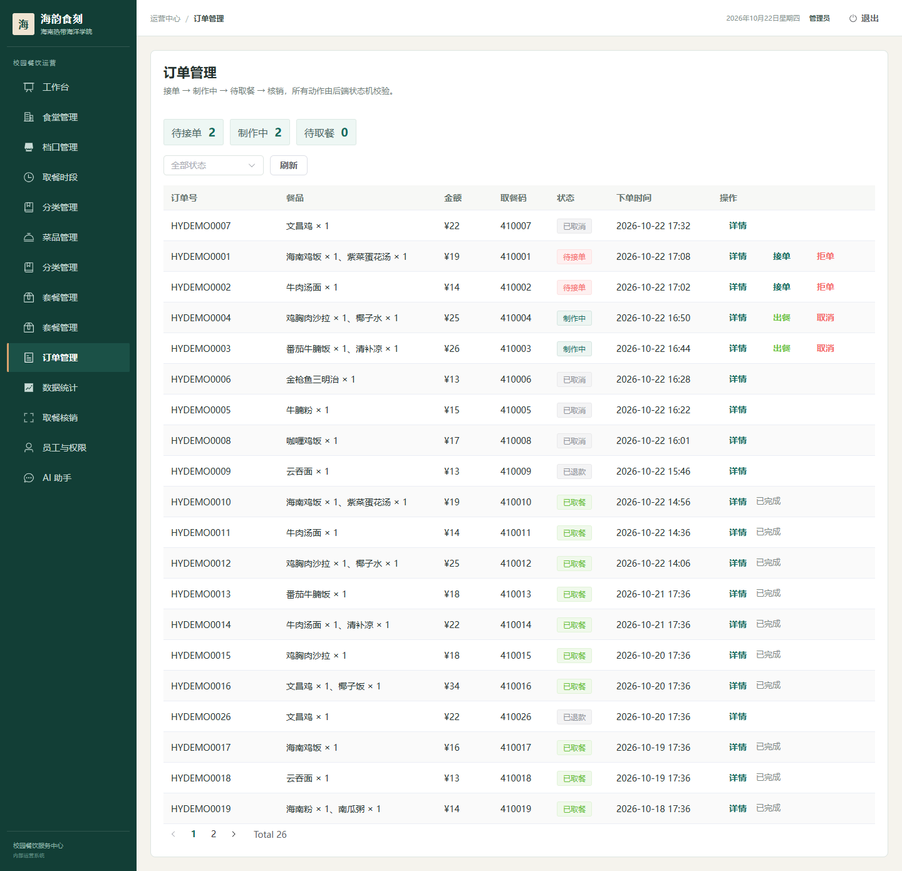
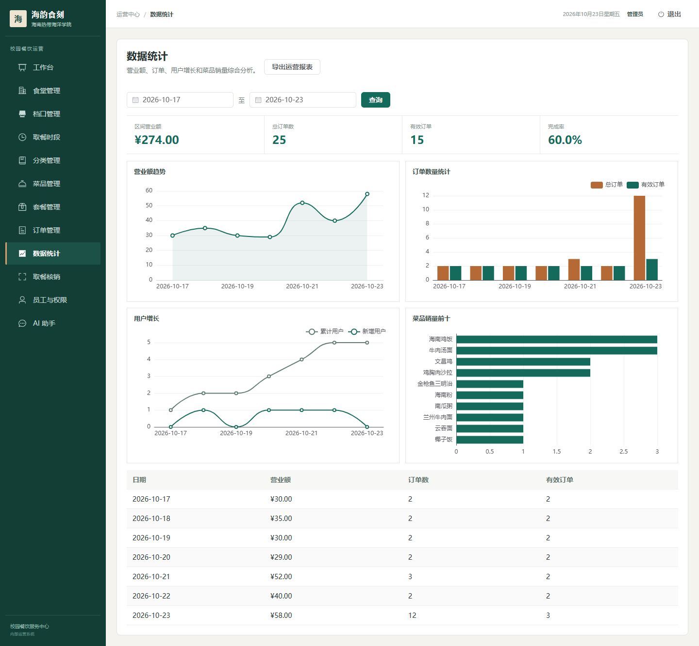
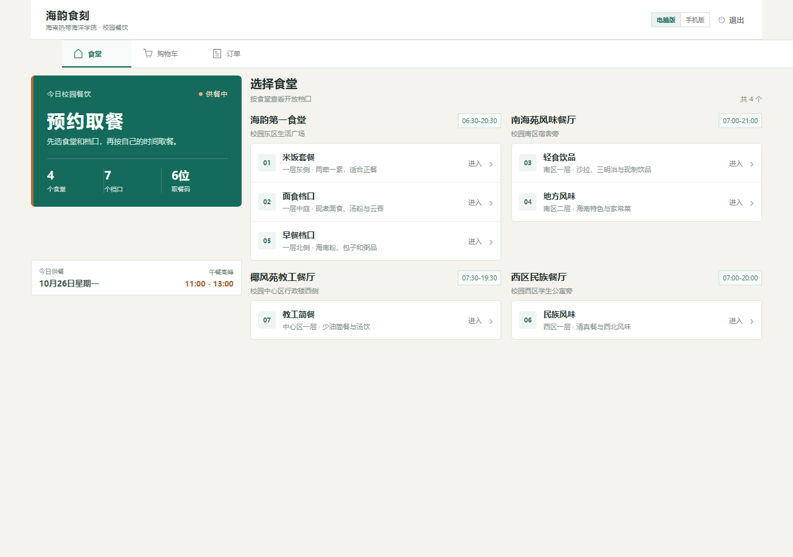
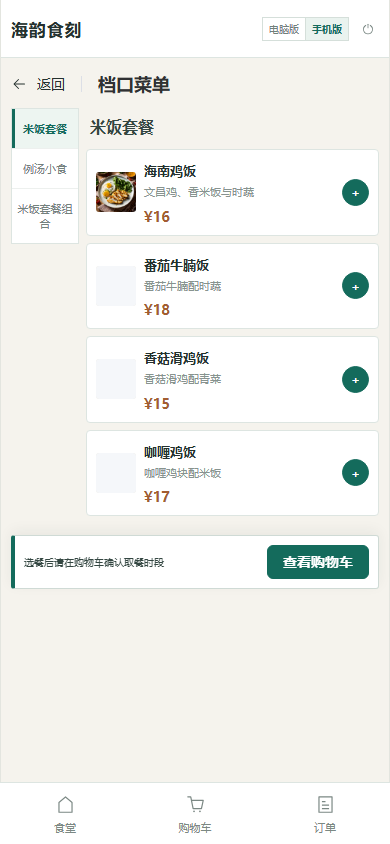

# 海韵食刻 · 校园食堂预约取餐平台

> 学生按「食堂 → 档口 → 菜品 → 取餐时段」预约下单，档口备餐，学生凭 6 位取餐码到店核销。

海韵食刻是一个 Java 后端主导、Vue 3 前端 AI 辅助完成的全栈项目。项目围绕校园预约取餐场景重构，包含时段库存、订单状态机、模拟支付、取餐核销、RBAC、Redis 缓存、traceId 和 AI 业务助手。

## 管理端登录



---

## 界面预览

### 管理端

| 运营工作台 | 菜品管理 |
|---|---|
|  |  |

| 订单管理 | 数据统计 |
|---|---|
|  |  |

### 学生端

| 电脑版首页 | 手机版菜单 |
|---|---|
|  |  |

> 截图来自本地真实页面和演示数据。

## 功能

### 学生端

- 学号 + 密码登录；
- 学生注册和学号唯一校验；
- 浏览食堂、档口、分类和菜品；
- 查看菜品详情、口味和价格；
- 按档口隔离购物车；
- 选择取餐日期和时段；
- 提交订单并占用时段容量；
- 模拟支付；
- 查看订单详情、历史订单和 6 位取餐码；
- 取消订单、再来一单；
- 电脑版、手机版自动切换，也可手动切换。

### 管理端

- 管理员登录与 RBAC 权限；
- 工作台经营概览；
- 食堂、档口和取餐时段管理；
- 分类、菜品、套餐管理；
- 订单查询、接单、拒单、出餐和取消；
- 取餐码核销与重复核销幂等；
- 员工、角色和权限分配；
- 营业额、订单、用户和销量统计；
- AI 助手流式对话、历史会话和写操作确认。

## 技术栈

| 层次 | 技术 |
|---|---|
| 后端 | Java 21、Spring Boot 3.5、MyBatis、MySQL 8、Redis |
| 权限 | JWT、RBAC、自定义 `@RequirePermission`、AOP |
| 数据一致性 | 条件更新、订单状态 CAS、唯一索引、支付回调幂等 |
| AI | LangChain4j、通义千问、工具调用、Redis 会话记忆 |
| 前端 | Vue 3、Vite、TypeScript、Element Plus、Pinia、Vue Router |
| 可观测性 | traceId、Actuator、Micrometer、Prometheus |
| 部署 | Nginx、静态资源托管、API 与 WebSocket 反向代理 |

前端使用 TypeScript，Vite 构建时会编译为浏览器运行的 JavaScript，并在构建阶段执行类型检查。

## 项目结构

```text
haiyun-campus-meal/
├─ haiyun-common/   常量、异常、枚举、工具和 JWT
├─ haiyun-model/    Entity、DTO、VO
├─ haiyun-app/      Controller、Service、Mapper、Task、Config
├─ db/              完整建库脚本、迁移脚本和演示数据
├─ scripts/         本地冒烟测试
├─ screenshots/     README 页面截图
├─ web/             Vue 3 管理端与学生 H5
└─ pom.xml
```

## 本地部署

### 1. 环境要求

| 软件 | 建议版本 |
|---|---|
| JDK | 21 |
| Maven | 3.9+ |
| MySQL | 8.0+ |
| Redis | 6+ / 7+ |
| Node.js | 20+ |
| npm | 10+ |

真实微信支付不是本地运行必需项，项目默认使用模拟支付。

### 2. 克隆项目

```powershell
git clone --branch master https://github.com/tlei49377-afk/haiyun-campus-meal.git
cd haiyun-campus-meal
```

### 3. 启动 MySQL 和 Redis

启动 MySQL 后导入完整演示数据库：

```powershell
cmd /c "mysql --default-character-set=utf8mb4 -uroot -p < db\haiyun_meal.sql"
```

Linux/macOS：

```bash
mysql --default-character-set=utf8mb4 -uroot -p < db/haiyun_meal.sql
```

启动 Redis：

```powershell
redis-server
```

也可以使用 Docker：

```powershell
docker run --rm -d --name haiyun-redis -p 6379:6379 redis:7-alpine
redis-cli ping
```

应返回：

```text
PONG
```

### 4. 创建本地配置

```powershell
Copy-Item haiyun-app\src\main\resources\application-dev.yml.example haiyun-app\src\main\resources\application-dev.yml
```

至少修改：

```yaml
app:
  datasource:
    host: localhost
    port: 3306
    database: haiyun_meal
    username: root
    password: your-mysql-password

  redis:
    host: localhost
    port: 6379
    password: your-redis-password
    database: 10

  jwt:
    admin-secret-key: please-change-to-a-32-byte-random-string
    user-secret-key: please-change-to-another-32-byte-string
```

说明：

- `application-dev.yml` 已被 `.gitignore` 排除，不会上传数据库密码和密钥；
- Redis 无密码时将 `password` 留空；
- 只有上传新图片时才需要配置 OSS；
- 只有真实微信登录或支付时才需要配置微信参数；
- AI 可选配置：

```powershell
$env:QW-API-KEY="your-dashscope-api-key"
```

未配置 AI Key 时，非 AI 功能仍可正常使用。

### 5. 启动后端

```powershell
mvn clean test
mvn -q -DskipTests install
mvn -q -pl haiyun-app spring-boot:run
```

服务地址：

- API：`http://localhost:8080`
- 健康检查：`http://localhost:8080/actuator/health`
- 接口文档：`http://localhost:8080/doc.html`

### 6. 启动前端

打开新的终端：

```powershell
cd web
npm ci
npm run dev
```

访问：

- 登录页：`http://localhost:5173/login`
- 管理端：`http://localhost:5173/admin/dashboard`
- 学生端：`http://localhost:5173/student/home`

Vite 会将 `/api` 和 `/ws` 代理到 `http://localhost:8080`。

### 7. 生产构建

```powershell
cd web
npm run build
```

构建产物位于 `web/dist/`，Nginx 示例见 `web/conf/nginx.conf`。

## 演示账号

| 端 | 账号 | 密码 |
|---|---|---|
| 管理端 | `admin` | `123456` |
| 学生端 | `20230001` | `123456` |

## 部署验证

后端启动后执行项目内置冒烟测试：

```powershell
powershell -ExecutionPolicy Bypass -File .\scripts\smoke-test.ps1 -BaseUrl http://localhost:8080
```

会验证：

```text
学生登录
→ 浏览食堂/档口/菜品
→ 加入购物车
→ 选择时段
→ 提交订单
→ 模拟支付
→ 管理员接单
→ 出餐
→ 取餐码核销
```

前端构建验证：

```powershell
cd web
npm run build
```

演示数据库包含：

- 4 个食堂；
- 8 个档口；
- 40 个菜品及图片；
- 4 个套餐；
- 72 个取餐时段；
- 26 笔演示订单。

## 核心设计

### 时段容量占位

```sql
UPDATE pickup_slot
SET booked = booked + 1
WHERE id = ?
  AND status = 1
  AND booked < capacity;
```

占位和订单写入在同一个事务内。取消、拒单或超时关闭时，订单状态更新成功后再释放时段库存，避免重复释放。

### 订单状态机

```text
10 待支付 → 20 待接单 → 30 制作中 → 40 待取餐 → 50 已取餐
                                      ↘ 60 已取消
20/30 → 70 已退款
```

关键状态使用 `WHERE id = ? AND status = ?` 条件更新，避免支付、超时任务和人工操作互相覆盖。

### 权限与 traceId

- 登录返回权限码列表；
- 后端通过 `@RequirePermission` 和 AOP 校验；
- 前端按权限码过滤菜单和路由；
- 请求透传 `X-Trace-Id`，错误提示支持查看和复制。

## 主要接口

| 方法 | 地址 | 说明 |
|---|---|---|
| POST | `/api/admin/employee/login` | 管理端登录 |
| GET | `/api/admin/order/conditionSearch` | 订单分页查询 |
| PUT | `/api/admin/order/confirm` | 接单 |
| PUT | `/api/admin/order/ready/{id}` | 出餐 |
| POST | `/api/admin/order/pickup/verify` | 取餐核销 |
| POST | `/api/app/user/login` | 学生登录 |
| POST | `/api/app/user/register` | 学生注册 |
| GET | `/api/app/dish/{id}` | 菜品详情 |
| POST | `/api/app/order/submit` | 提交订单并占位 |
| PUT | `/api/app/order/payment` | 模拟支付 |

## 常见问题

### MySQL 导入中文乱码

```powershell
cmd /c "mysql --default-character-set=utf8mb4 -uroot -p < db\haiyun_meal.sql"
```

### Redis 连接失败

检查 Redis 是否启动，以及 `application-dev.yml` 中的 host、port、password 和 database。

### AI 助手不可用

确认 Redis 正常，并设置 `QW-API-KEY` 后重启后端。

### 前端 401 或菜单为空

确认后端运行在 8080，重新登录。权限菜单依赖管理员登录返回的权限码。

### 端口冲突

默认端口为 MySQL `3306`、Redis `6379`、后端 `8080`、前端 `5173`。修改端口后需同步修改 Vite 代理。

## 安全说明

- 不要提交 `application-dev.yml`、数据库密码、OSS Secret、微信证书或 AI Key；
- 演示账号和数据仅用于本地学习与展示；
- 生产部署前应轮换密钥、检查 Git 历史并配置服务器权限。
